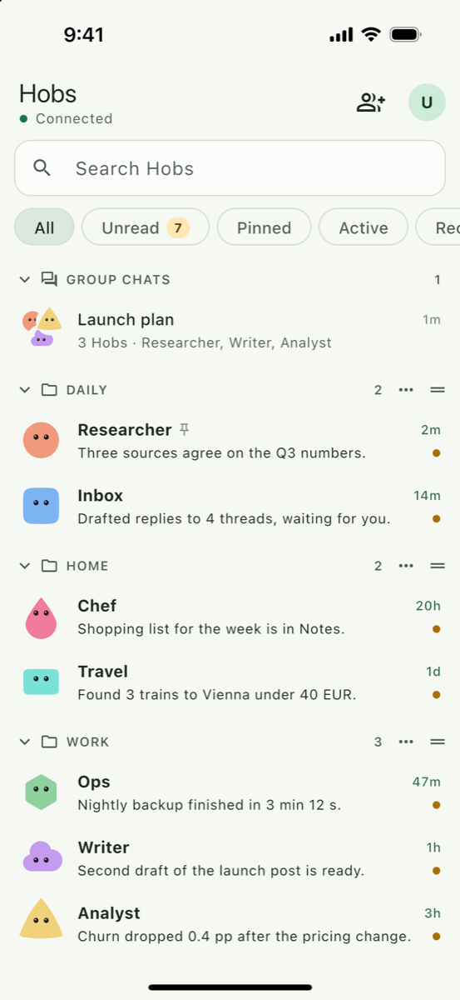
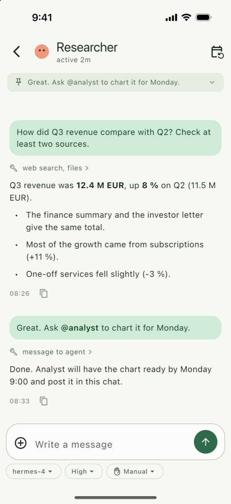
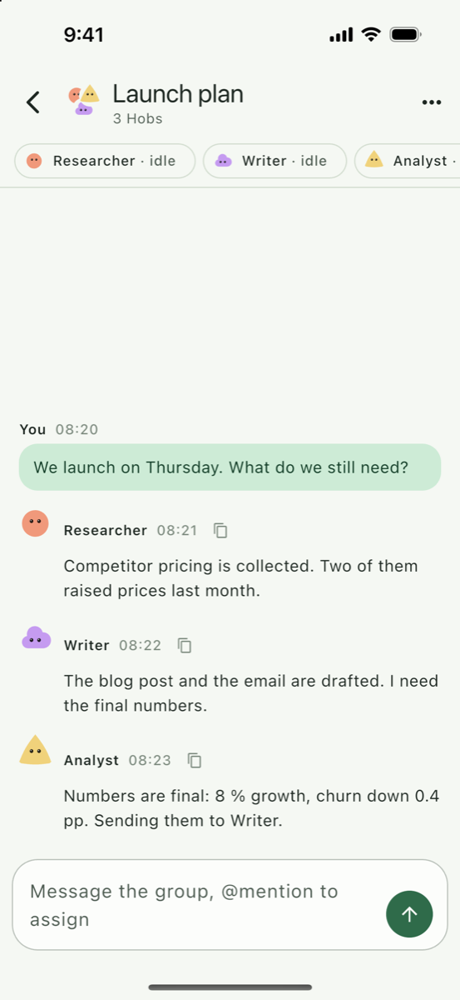
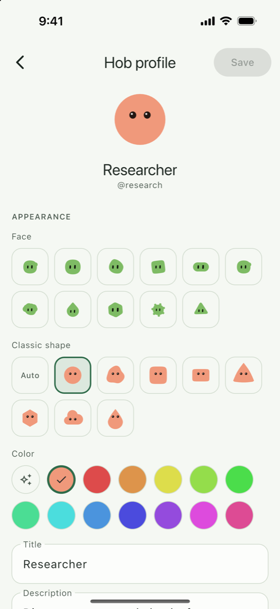

# Hermes Hobs

Talk to your Hobs from wherever you are.

Hermes Hobs is a chat app for Hermes Agent. Every bot from your dashboard's
Bot Mode shows up here as a **Hob**, with its own chat. Same bots, a friendlier
name. It runs on Android, iPhone, iPad and Mac.

Hermes Hobs is an unofficial community app. It is not made, endorsed or
supported by Nous Research, the makers of Hermes Agent.

No server yet? [Try the demo](#try-it-without-a-server).

  
  
  
  

## What it does

- **One chat per Hob.** Replies stream in as the Hob writes them, with the
  tools it used. Approve a command or answer a question right in the chat.
- **Tag other Hobs.** Type `@` to pull another Hob into the conversation.
- **Group chats.** Ask 2 to 6 Hobs at once and read their answers in one
  thread.
- **Your list, your way.** Folders, pins, hidden Hobs, and filters for unread,
  pinned, active and recent.
- **New Hobs.** Create a bot from the app. It shows up on the dashboard too.
- **Hob profiles.** Change a Hob's face, color, title, description, model and
  SOUL.md. Edits go straight to the bot on your server.
- **Scheduled jobs.** See a Hob's jobs, switch them on and off, run one
  now, read its run history, delete it or schedule a new one. A job's output
  shows up in the Hob's chat as a card of its own.
- **Per-chat settings.** Switch the model, reasoning level and approval mode
  from the composer.
- **Attachments.** Send photos, files up to 16 MB and links, or share them
  into a Hob from any other app.
- **Notifications.** Hear about it when a Hob finishes a reply or waits for
  you, in a Hob chat or a group chat.
- **Several servers.** Add each Hermes server as its own account with a name
  and color, and switch between them from your avatar.
- **Offline bar.** Without internet, a bar asks you to turn on Wi-Fi or
  mobile data, and the chats reconnect as soon as it is back.
- **Face ID, Touch ID or fingerprint** lock the app when you leave it.
- Czech and English.

## Get started

1. Install the app from [Google Play](https://play.google.com/store/apps/details?id=cz.devrel.hermeshobs).
2. Enter your Hermes Agent dashboard's address.
3. Sign in with the dashboard's username and password. Your bots appear as
   Hobs.

To add another server, tap your avatar and pick *Add server*. Only the
account you are in stays connected and sends notifications.

## Try it without a server

Tap *Try the demo* on the sign-in screen. The app signs in to a demo account
with the Hobs and chats from the screenshots. Everything stays on your device,
replies are canned, and the demo starts fresh each time you open the app.

## Good to know

- Notifications come from the app itself, not from a push service. On iPhone
  and iPad, a Hob that answers more than about 30 seconds after you leave the
  app notifies you only when you open it again.
- Unread marks, collapsed folders and folder order stay on each device. A
  chat you read elsewhere still shows as unread here; *Mark all as read* in
  the account menu clears it.
- Not supported yet: the SESSIONS tab, group chats with Hobs from another
  gateway, routing settings, and attachments in group chats.
- There is no web version.

## Privacy

The [privacy policy](docs/privacy-policy.md) explains what the app does with
your data.

## For developers

- [Development](docs/development.md): build, run, test and release
- [How it works](docs/how-it-works.md): accounts, biometric lock,
  notifications, every call the app makes to Hermes, attachments
- [Google Play release](docs/google-play.md): signing, store listing, release
  history

## License

Hermes Hobs is released under the [MIT License](LICENSE). The bundled Geist
fonts keep their own [SIL Open Font License](assets/fonts/OFL.txt).
